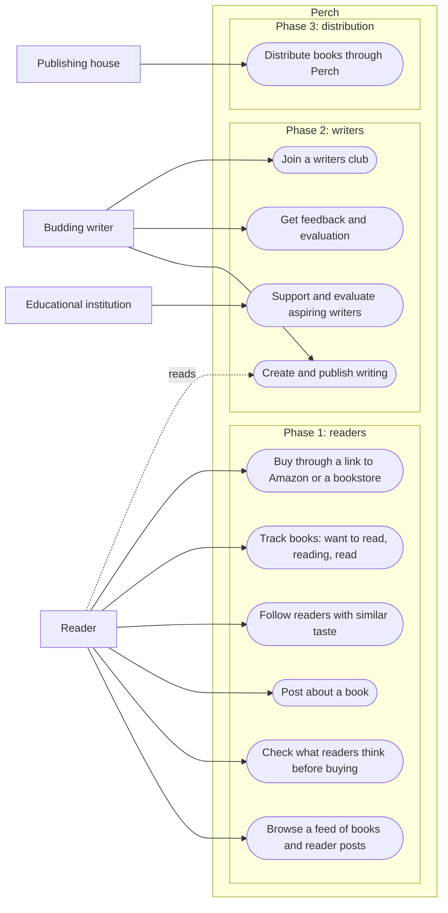

# Perch

A dedicated social space for books, built like Instagram. Readers discover books through other readers instead of through promotion feeds and marketplace reviews.

## The idea

* A book-first social platform: a feed of books and what readers think of them, in the format people already scroll.
* Discovery through readers you trust, not through paid promotion or anonymous marketplace reviews.
* Easy creation and publishing support for writers, so new voices reach readers directly.
* A club for budding writers, with outreach to educational institutions for support and evaluation of aspiring writers.
* Tie-ups with publishing houses for distribution. Not against Amazon; buying can still happen there.

### Where it came from

Instagram promotions led to a few books that were not up to the mark. Checking Amazon and Google reviews did not prevent it. Reading *Yellowface* raised the question of how much PR shapes what reaches the shelf, and no existing product seemed to play this role.

### Order of build

1. Readers first.
2. Writers next, once the reader base exists.
3. Publishing-house distribution after that.

## End users

|User|Who they are|What they want from Perch|
|---|---|---|
|Reader|Came to books through social media. Reads around 15 physical books a year. Hears about books on Instagram, then friends, then bookstore bestseller tables. Buys on Amazon or in a bookstore.|Find books they will actually like, before paying for them.|
|Budding writer|Writing something and wants readers and feedback.|Create, publish, get evaluated, find an audience.|
|Educational institution|Teaches or supports aspiring writers.|A place to support and evaluate student writers.|
|Publishing house|Publishes and distributes books.|Reach readers through a trusted channel.|

## Use case diagram

## Use cases

### Phase 1: readers

|ID|Use case|Actor|
|---|---|---|
|UC1|Browse a feed of books and reader posts|Reader|
|UC2|Check what readers think of a book before buying it|Reader|
|UC3|Post about a book: a reaction, a review, a recommendation|Reader|
|UC4|Follow readers with similar taste|Reader|
|UC5|Track books as want to read, reading, or read|Reader|
|UC6|Buy through a link to Amazon or a bookstore|Reader|

### Phase 2: writers

|ID|Use case|Actor|
|---|---|---|
|UC7|Create and publish writing on the platform|Budding writer|
|UC8|Get feedback and evaluation on published writing|Budding writer|
|UC9|Join a writers club|Budding writer|
|UC10|Support and evaluate aspiring writers|Educational institution|

### Phase 3: distribution

|ID|Use case|Actor|
|---|---|---|
|UC11|Distribute books to readers through Perch|Publishing house|

---
