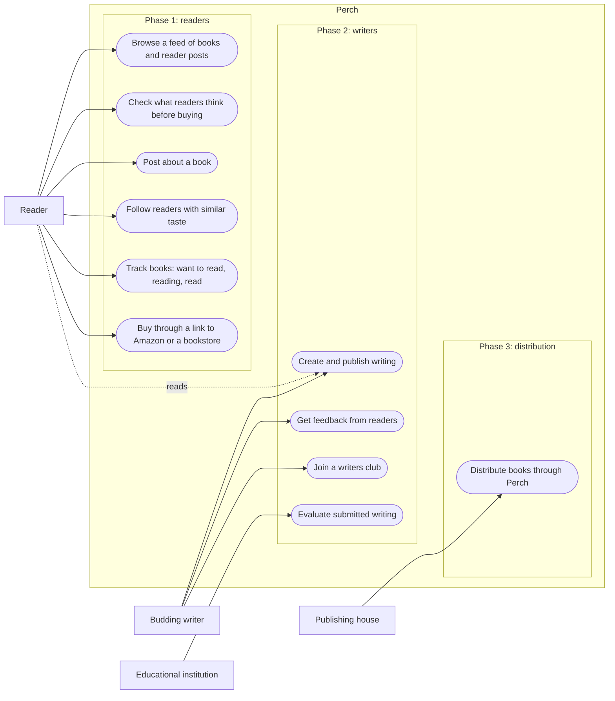
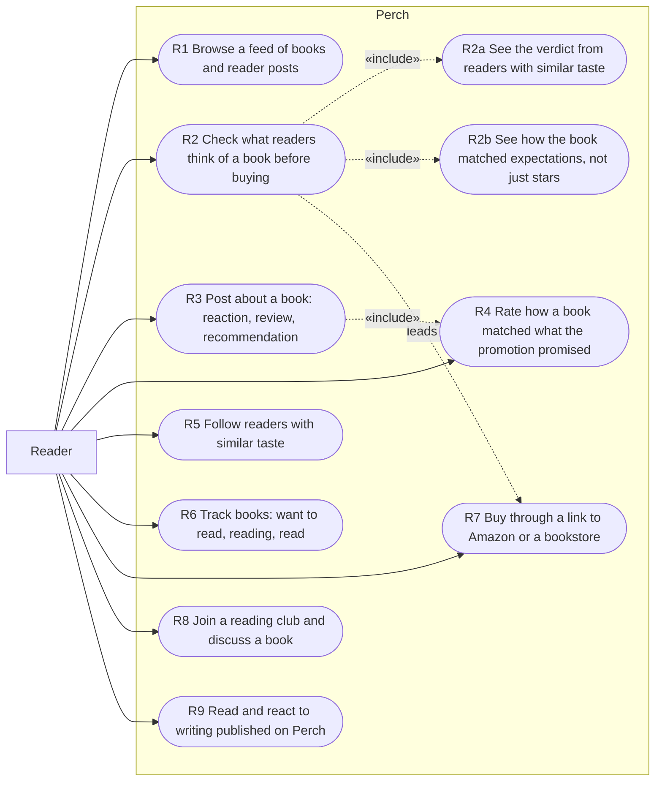
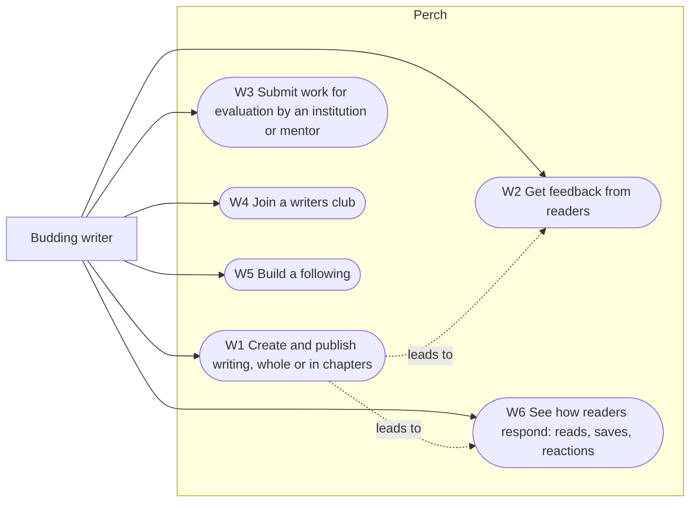
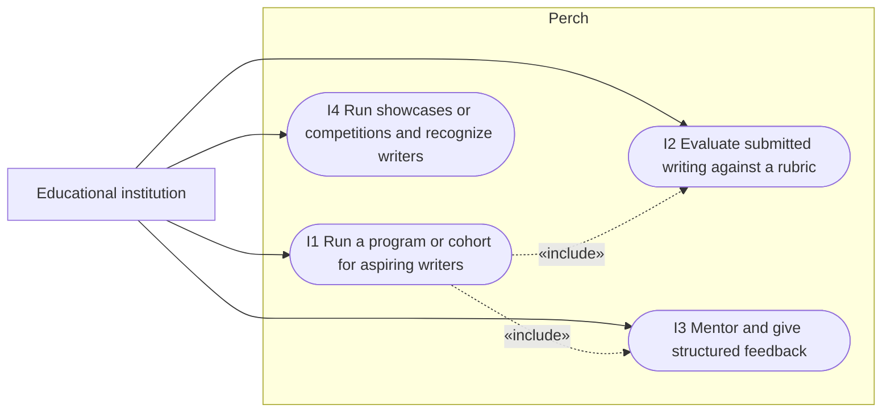
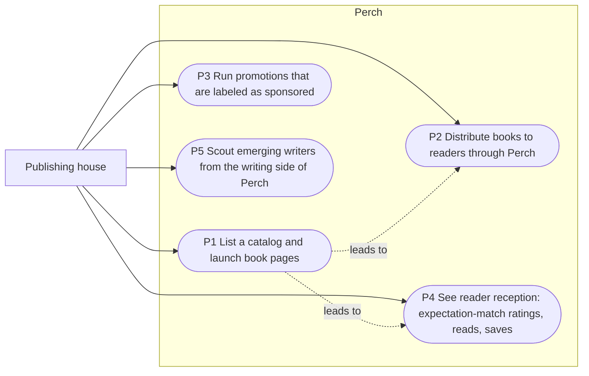
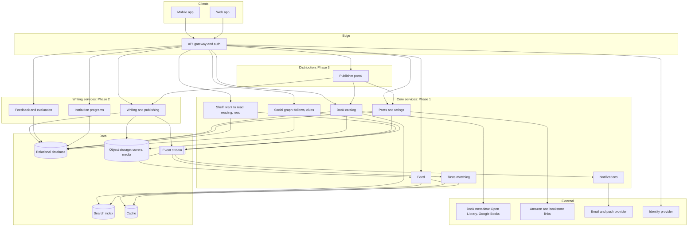

# Perch

**Status: concept. No code yet. User research in planning.**

A dedicated social space for books, built like Instagram. Readers discover books through other readers instead of through promotion feeds and marketplace reviews.

## The idea

- A book-first social platform: a feed of books and what readers think of them, in the format people already scroll.
- Discovery through readers you trust, not through paid promotion or anonymous marketplace reviews.
- Easy creation and publishing support for writers, so new voices reach readers directly.
- A club for budding writers, with outreach to educational institutions for support and evaluation of aspiring writers.
- Tie-ups with publishing houses for distribution. Not against Amazon; buying can still happen there.

### Where it came from

Instagram promotions led to a few books that were not up to the mark. Checking Amazon and Google reviews did not prevent it. Reading *Yellowface* raised the question of how much PR shapes what reaches the shelf, and no existing product seemed to play this role.

### Order of build

1. Readers first.
2. Writers next, once the reader base exists.
3. Publishing-house distribution after that.

## End users

| User | Who they are | What they want from Perch |
|---|---|---|
| Reader | Came to books through social media. Reads around 15 physical books a year. Hears about books on Instagram, then friends, then bookstore bestseller tables. Buys on Amazon or in a bookstore. | Find books they will actually like, before paying for them. |
| Budding writer | Writing something and wants readers and feedback. | Create, publish, get evaluated, find an audience. |
| Educational institution | Teaches or supports aspiring writers. | A place to support and evaluate student writers. |
| Publishing house | Publishes and distributes books. | Reach readers through a trusted channel. |

## System overview

All four actors against the system boundary. Core use cases only; the full set per actor follows.

## Use cases by actor

Each diagram shows one actor and everything they can do in the system. Dotted arrows marked «include» are steps that always happen as part of the parent use case.

### Reader

Phase 1. The reader is the wedge; everything here ships first.

| ID | Use case | Notes |
|---|---|---|
| R1 | Browse a feed of books and reader posts | The Instagram-shaped surface |
| R2 | Check what readers think of a book before buying it | The core job. Replaces the Amazon and Google review check |
| R2a | See the verdict from readers with similar taste | Always part of R2. Needs R5 data |
| R2b | See how the book matched expectations, not just stars | Always part of R2. Fed by R4 |
| R3 | Post about a book | Reaction, review, or recommendation |
| R4 | Rate how a book matched what the promotion promised | Always asked when posting. This is the signal Amazon does not have |
| R5 | Follow readers with similar taste | Builds the trust graph |
| R6 | Track books as want to read, reading, or read | Shelf |
| R7 | Buy through a link to Amazon or a bookstore | Perch does not sell; it hands off |
| R8 | Join a reading club and discuss a book | Group reading |
| R9 | Read and react to writing published on Perch | Phase 2 crossover: readers are the audience for writers |

### Budding writer

Phase 2. Gated on evidence that a meaningful share of active readers also write.

| ID | Use case | Notes |
|---|---|---|
| W1 | Create and publish writing, as a whole or in chapters | The publishing tool |
| W2 | Get feedback from readers | Comes from R9 on the reader side |
| W3 | Submit work for evaluation by an institution or mentor | Connects to I2 |
| W4 | Join a writers club | Peer group |
| W5 | Build a following | Same follow graph as readers, R5 |
| W6 | See how readers respond | Reads, saves, reactions on published work |

### Educational institution

Phase 2. An institution is a partner account, not an individual.

| ID | Use case | Notes |
|---|---|---|
| I1 | Run a program or cohort for aspiring writers | A cohort groups writers under the institution |
| I2 | Evaluate submitted writing against a rubric | Receives W3 submissions |
| I3 | Mentor and give structured feedback | Different from reader feedback in W2: structured, attributed |
| I4 | Run showcases or competitions and recognize writers | Recognition shows on the writer's profile |

### Publishing house

Phase 3. Depends on a reader base that does not exist yet.

| ID | Use case | Notes |
|---|---|---|
| P1 | List a catalog and launch book pages | Publisher-verified book pages |
| P2 | Distribute books to readers through Perch | Fulfilment still via Amazon or bookstores, R7 |
| P3 | Run promotions that are labeled as sponsored | Promotion is allowed, hiding it is not. This is what makes Perch different from the Instagram feed |
| P4 | See reader reception | Expectation-match ratings from R4, reads, saves |
| P5 | Scout emerging writers | Reads W6 signals. The Yellowface thread, done in the open |

## Component diagram

Responsibilities, not technology choices. Stack is undecided. Phase labels match the build order.

### What each component owns

| Component | Owns | Used by |
|---|---|---|
| API gateway and auth | Routing, sessions, rate limits | All clients |
| Book catalog | Canonical book records, covers, search | R1, R2, R6, P1 |
| Feed | Ranking and assembling what a reader sees | R1 |
| Posts and ratings | Reader posts, expectation-match ratings, buy links | R3, R4, R7, P4 |
| Social graph | Follows, clubs, cohorts | R5, R8, W4, W5, I1 |
| Taste matching | Similar-taste scoring from posts, shelves, follows | R2a, R5 |
| Shelf | Want to read, reading, read | R6 |
| Notifications | Push and email | All actors |
| Writing and publishing | Drafts, chapters, published works | W1, R9 |
| Feedback and evaluation | Reader feedback, rubric evaluations, mentor notes | W2, W3, I2, I3 |
| Institution programs | Cohorts, showcases, competitions, recognition | I1, I4 |
| Publisher portal | Catalog listing, labeled promotions, reception analytics, scouting | P1 to P5 |
| Event stream | Every post, rating, shelf change, follow, publish | Taste matching, Feed, Notifications |

---

Reader use cases R1, R3, R5, and R6 are read off "like Instagram": feed, post, follow, save. R4 and P3 are proposals that follow from the problem statement: the signal that is missing today is whether a book matched its promotion, and promotion itself is fine as long as it is labeled. Edit anything that is not what you meant.
