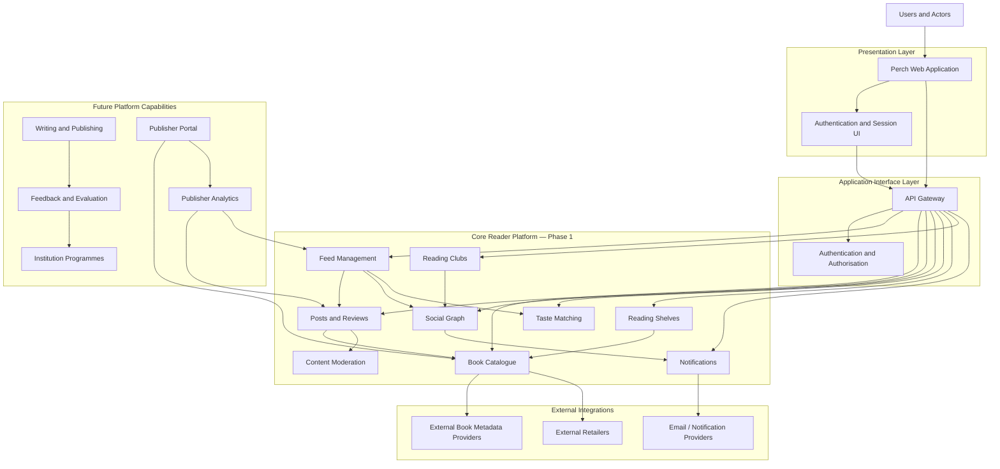

# Perch — Component Diagram

## 1. Overview

Perch is organised into logical components responsible for user interaction, book discovery, social interactions, reading activity and future ecosystem capabilities.

The component model is independent of the presentation platform. The initial client is a desktop-first responsive web application.

## 2. High-Level Component Diagram

## 3. Component Responsibilities

### Presentation Layer

| Component | Responsibility |
|---|---|
| Perch Web Application | Browser-based user experience, page rendering and user interactions |
| Authentication and Session UI | Sign-up, login, logout and session-related user flows |

### Application Interface Layer

| Component | Responsibility |
|---|---|
| API Gateway | Application entry point, request routing and interface between client and backend capabilities |
| Authentication and Authorisation | Identity verification, session validation and permission enforcement |

### Core Reader Platform — Phase 1

| Component | Responsibility |
|---|---|
| Feed Management | Assemble and deliver reader feeds |
| Book Catalogue | Maintain book information, authors, genres and external links |
| Posts and Reviews | Create and manage reactions, recommendations and reviews |
| Social Graph | Manage reader relationships, follows and social interactions |
| Taste Matching | Identify readers with overlapping reading preferences |
| Reading Shelves | Manage Want to Read, Currently Reading and Read |
| Reading Clubs | Support reading communities and discussions |
| Notifications | Deliver relevant activity updates |
| Content Moderation | Handle reports, content review and moderation states |

### Future Platform Capabilities

| Component | Responsibility |
|---|---|
| Writing and Publishing | Create and publish writing works and chapters |
| Feedback and Evaluation | Collect reader, mentor and institutional feedback |
| Institution Programmes | Manage writing programmes, cohorts and evaluation workflows |
| Publisher Portal | Manage publisher identity, verified catalogue and promotions |
| Publisher Analytics | Present reader reception and engagement insights |

### External Integrations

| Component | Responsibility |
|---|---|
| Book Metadata Providers | Retrieve or enrich book catalogue information |
| External Retailers | Provide outbound book purchase destinations |
| Email / Notification Providers | Deliver notifications through external channels where needed |

## 4. Important Component Interactions

### Feed generation
- Feed Management retrieves relevant posts.
- Social Graph supplies followed-reader relationships.
- Taste Matching provides relevant reader context.
- Posts and Reviews supplies post content.
- The assembled feed is returned to the web application.

### Book discovery
- Book Catalogue provides book information.
- Feed Management and Discover surfaces book-related content.
- Posts and Reviews provides reader opinions.
- Taste Matching helps surface perspectives from similar readers.
- External Retailers provide outbound purchase destinations.

### Reader publishing
- Posts and Reviews accepts a reader's post or review.
- Book Catalogue resolves the associated book.
- Content Moderation handles reporting and moderation.
- Notifications informs relevant users of activity.

### Reading shelves
- Reading Shelves manages a reader's book status.
- Book Catalogue supplies book information.
- Shelf information may contribute to taste matching and discovery.

## 5. Component Boundaries and Design Principles

1. Each component owns a clearly defined product responsibility.
2. Components communicate through defined interfaces rather than directly depending on internal implementation details.
3. Book catalogue data should be reusable across feeds, reviews, shelves and publisher functionality.
4. Taste Matching should remain logically separate from Feed Management.
5. Content moderation should be available across user-generated content.
6. Future writer, institution and publisher components should not complicate the Phase 1 reader experience.
7. External retailer integration should remain an outbound-link capability in Phase 1.

## 6. Architecture Decisions Not Yet Made

This diagram does not imply a microservices architecture.

The following decisions remain open:

- Modular monolith versus distributed services.
- Frontend framework and component system.
- Backend framework and API style.
- Database and search technology.
- Feed ranking and taste-matching implementation.
- Authentication provider.
- Book metadata source and licensing.
- Hosting, deployment and observability.
- Event-driven processing requirements.

These decisions should follow technical feasibility analysis and MVP requirements, not be inferred from this logical component diagram.

