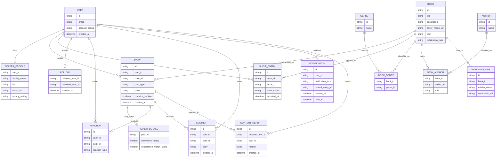

# Perch — Conceptual Domain Model

**Note:** This is a platform-neutral conceptual model. The move to web-first changes navigation and interaction design, not the core reader, book and post concepts. This is not a final database schema.

## 1. Phase 1 Entities

## 2. Domain Rules

1. A reader has one shelf status per book in the simplest MVP model.
2. Enjoyment and expectation-match ratings are separate values.
3. Expectation match measures whether a book met the reader's expectations, not whether the reader personally enjoyed it.
4. A post may be a reaction, recommendation or structured review. Validate whether separate post types are necessary.
5. A post references one book in the initial release. Multi-book posts can be considered later.
6. Purchase links lead to external retailers. Perch does not own checkout or fulfilment in Phase 1.
7. Taste similarity can be derived from reader activity and preferences; it may not need a persisted entity initially.
8. Similarity indicators should avoid implying certainty and should expose evidence where practical.
9. Profile and shelf visibility rules must be defined before implementation.
10. Reporting and moderation should be supported, even if moderation operations are initially lightweight.

## 3. Future-Phase Extensions

These are not Phase 1 requirements.

### Writer ecosystem
- `WRITING_WORK`
- `CHAPTER`
- `WRITING_FEEDBACK`
- `WRITER_FOLLOW`

### Institution ecosystem
- `INSTITUTION`
- `PROGRAM`
- `COHORT`
- `EVALUATION_RUBRIC`
- `EVALUATION`

### Publisher ecosystem
- `PUBLISHER`
- `PUBLISHER_CATALOG_ENTRY`
- `SPONSORED_CAMPAIGN`
- `CAMPAIGN_METRIC`

## 4. Open Domain Decisions

- Is a book represented as a work, an edition, or both?
- Can one post reference multiple books?
- Are ratings numeric, categorical or both?
- Can readers create custom shelves?
- Which profile and shelf fields are public by default?
- How should duplicate book metadata and merged editions be handled?
- What minimum sample size is needed before displaying aggregate expectation-match or taste-match signals?
