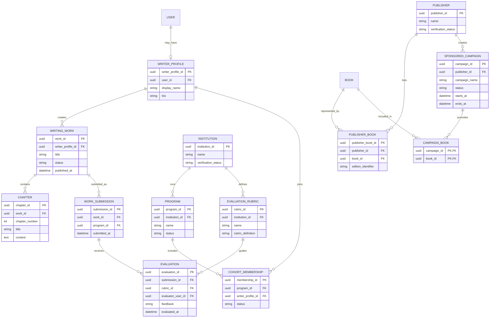

# Perch — Domain Model

**Status:** Conceptual domain model  
**Scope:** Phase 1 core, with Phase 2/3 extensions  
**Note:** This is a logical model, not a finalized database schema.

## 1. Core domain diagram

```mermaid
erDiagram
    USER ||--|| READER_PROFILE : has
    USER ||--o{ POST : creates
    USER ||--o{ FOLLOW : initiates
    USER ||--o{ SHELF_ENTRY : maintains
    USER ||--o{ REACTION : makes
    USER ||--o{ COMMENT : writes
    USER ||--o{ NOTIFICATION : receives
    USER ||--o{ CONTENT_REPORT : submits

    BOOK ||--o{ POST : discussed_in
    BOOK ||--o{ SHELF_ENTRY : saved_as
    BOOK ||--o{ BOOK_AUTHOR : credits
    AUTHOR ||--o{ BOOK_AUTHOR : writes
    BOOK ||--o{ BOOK_GENRE : classified_as
    GENRE ||--o{ BOOK_GENRE : categorizes
    BOOK ||--o{ PURCHASE_LINK : available_through

    POST ||--o| REVIEW_DETAILS : may_have
    POST ||--o{ COMMENT : has
    POST ||--o{ REACTION : receives
    POST ||--o{ CONTENT_REPORT : reported_in
    USER ||--o{ REVIEW_DETAILS : submits

    USER {
        uuid user_id PK
        string email
        string username
        string auth_provider
        string account_status
        datetime created_at
    }

    READER_PROFILE {
        uuid user_id PK,FK
        string display_name
        string bio
        string avatar_url
        string visibility
    }

    BOOK {
        uuid book_id PK
        string canonical_external_id
        string title
        string description
        string cover_url
        string publication_date
    }

    AUTHOR {
        uuid author_id PK
        string name
        string bio
    }

    BOOK_AUTHOR {
        uuid book_id PK,FK
        uuid author_id PK,FK
        string author_role
    }

    GENRE {
        uuid genre_id PK
        string name
    }

    BOOK_GENRE {
        uuid book_id PK,FK
        uuid genre_id PK,FK
    }

    POST {
        uuid post_id PK
        uuid user_id FK
        uuid book_id FK
        string post_type
        string body
        string visibility
        datetime created_at
        datetime updated_at
    }

    REVIEW_DETAILS {
        uuid post_id PK,FK
        int expectation_match_score
        string expectation_context
    }

    SHELF_ENTRY {
        uuid shelf_entry_id PK
        uuid user_id FK
        uuid book_id FK
        string shelf_status
        datetime added_at
        datetime updated_at
    }

    FOLLOW {
        uuid follower_user_id PK,FK
        uuid followed_user_id PK,FK
        datetime created_at
    }

    REACTION {
        uuid reaction_id PK
        uuid user_id FK
        uuid post_id FK
        string reaction_type
        datetime created_at
    }

    COMMENT {
        uuid comment_id PK
        uuid user_id FK
        uuid post_id FK
        string body
        datetime created_at
    }

    PURCHASE_LINK {
        uuid purchase_link_id PK
        uuid book_id FK
        string retailer_name
        string destination_url
        string region
    }

    NOTIFICATION {
        uuid notification_id PK
        uuid recipient_user_id FK
        uuid actor_user_id FK
        string notification_type
        string target_type
        uuid target_id
        datetime created_at
        datetime read_at
    }

    CONTENT_REPORT {
        uuid report_id PK
        uuid reporter_user_id FK
        uuid post_id FK
        string reason
        string status
        datetime created_at
    }
```

## 2. Entity definitions

| Entity | Responsibility | Key notes |
|---|---|---|
| User | Authentication and account identity | Keep credentials/auth-provider details separate from public profile data |
| ReaderProfile | Public-facing reader identity | Bio, avatar, visibility and reading identity |
| Book | Canonical book record | Avoid duplicates using external identifiers where available |
| Author | Author identity | A book may have multiple authors |
| Genre | Controlled genre vocabulary | A book may belong to multiple genres |
| Post | Reader-generated content | Types may include review, recommendation, reaction and reading update |
| ReviewDetails | Structured review-specific information | Expectation-match score is separate from enjoyment |
| ShelfEntry | User-book reading relationship | Status: want_to_read, currently_reading, read |
| Follow | Directed reader-to-reader relationship | Unique follower/followed pair; prevent self-follow |
| Reaction | Lightweight post interaction | Reaction vocabulary to be finalized |
| Comment | Discussion on a post | Moderation and edit/delete rules required |
| PurchaseLink | External purchase handoff | Perch does not own checkout or fulfilment |
| Notification | User activity notification | Delivery preferences and read state |
| ContentReport | User-submitted moderation report | Requires moderation workflow and status transitions |

## 3. Important domain rules

1. A user may have one reader profile.
2. A user may create multiple posts.
3. A post in the Phase 1 book feed must be associated with a book. If general posts are later allowed, make `book_id` optional and define feed rules explicitly.
4. A review is a post with review-specific structured data.
5. Expectation-match score is not the same as enjoyment or overall book rating.
6. Expectation-match aggregation must retain the number of submitted ratings.
7. A user should have at most one active shelf entry per book, with status updated as reading progresses.
8. A user cannot follow themselves.
9. A user should not create duplicate follow relationships.
10. Purchase links point to external destinations; Perch does not process purchases in Phase 1.
11. User-generated content needs visibility, reporting and moderation rules.

## 4. Taste matching — derived capability

Taste matching should initially be treated as a derived capability, not necessarily a primary transactional entity.

Potential input signals:
- Explicit genre preferences.
- Books on Read and Want to Read shelves.
- Reviews and reactions.
- Follows and interactions.
- Optional enjoyment ratings, if introduced.

Potential outputs:
- Suggested readers.
- Reader-relevant posts.
- Book recommendations.

For an initial implementation, use transparent rules such as shared genres and overlapping books. Avoid implying sophisticated personalization before enough data exists.

## 5. Future-phase domain extensions

These are intentionally outside the Phase 1 core model.

## 6. Data-model decisions to make before implementation

- Will a book record represent a work, an edition, or both? ISBN usually identifies an edition, while readers often discuss a work across editions.
- Can a post contain multiple books, or exactly one?
- Are comments and reactions required in the first MVP?
- Is enjoyment rating separate from expectation match? The product concept suggests it should be.
- Can users keep shelves private?
- What is the policy for duplicate reviews or updating a review?
- Which external book metadata source provides canonical identifiers?
- How are deleted accounts and their posts handled?

## 7. Suggested implementation boundary

For the first release, prioritize:

- User and ReaderProfile
- Book, Author and Genre
- Post and ReviewDetails
- ShelfEntry
- Follow
- PurchaseLink

Add comments, reactions, notifications, reporting and clubs according to the final MVP scope and safety requirements. Keep future writer, institution and publisher entities out of the initial database migration unless there is a concrete near-term need.
