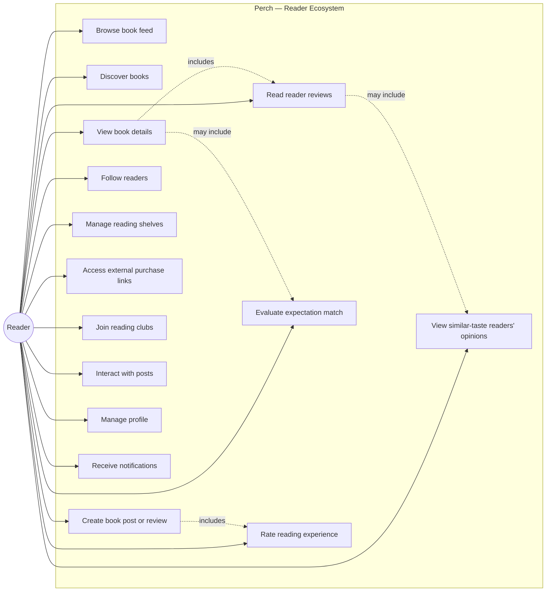
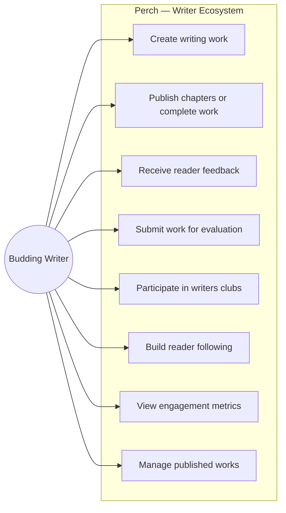
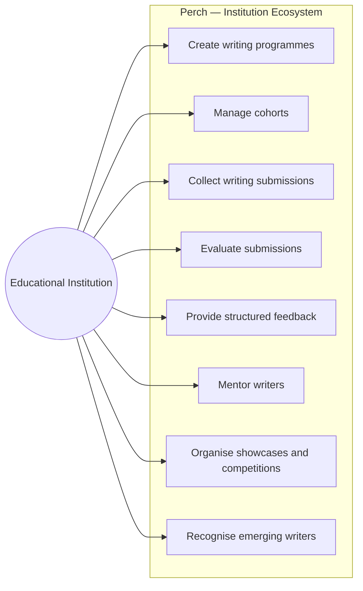
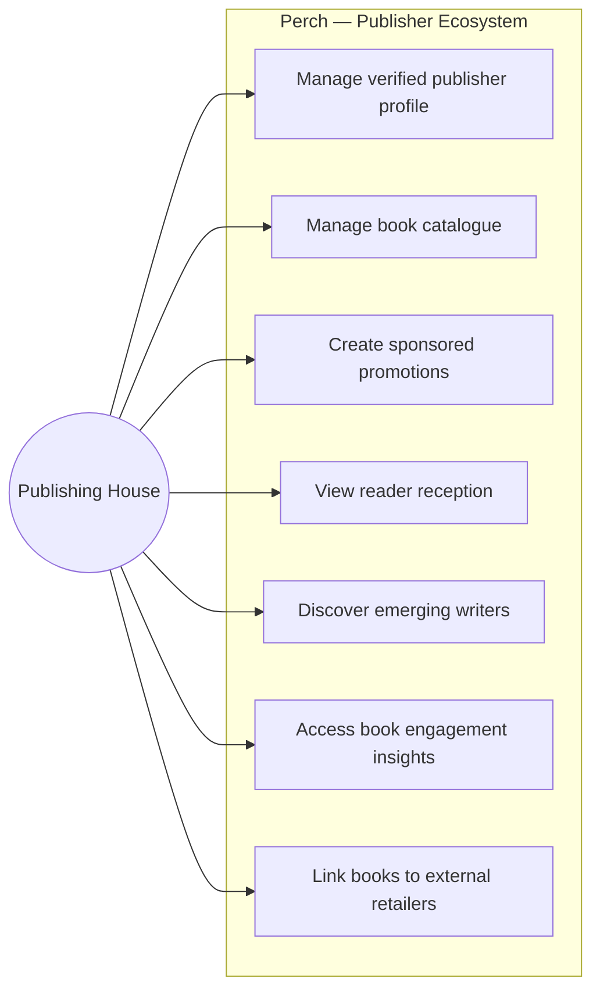

# Perch — Use Case Diagram

## 1. Overview

Perch has four primary actor groups:

1. **Reader** — discovers books through other readers, shares opinions and builds a reading network.
2. **Budding Writer** — publishes writing, receives feedback and builds an audience.
3. **Educational Institution** — supports, evaluates and showcases emerging writers.
4. **Publishing House** — manages verified book catalogues, promotes books and discovers emerging writers.

The product is planned across three phases:

- Phase 1: Reader ecosystem.
- Phase 2: Writer and institution ecosystem.
- Phase 3: Publisher ecosystem.

## 2. Reader Use Cases — Phase 1

### Reader use-case descriptions

| ID | Use case | Description |
|---|---|---|
| R1 | Browse feed | View book-related posts from readers |
| R2 | Discover books | Search and explore books by genre or interest |
| R3 | View book details | Access book information and reader reception |
| R4 | Read reviews | Evaluate opinions shared by readers |
| R5 | Similar-taste opinions | Find reviews from readers with overlapping reading preferences |
| R6 | Expectation match | Understand whether a book met reader expectations |
| R7 | Create post | Share a reaction, review or recommendation |
| R8 | Rate experience | Record enjoyment and expectation match separately |
| R9 | Follow readers | Build a network around reading interests |
| R10 | Manage shelves | Organise books into Want to Read, Currently Reading and Read |
| R11 | External purchase | Navigate to external retailer pages |
| R12 | Reading clubs | Join and participate in book communities |
| R13 | Interact | React to and comment on posts |
| R14 | Manage profile | Maintain reader identity and public reading activity |
| R15 | Notifications | Receive relevant social and community updates |

## 3. Budding Writer Use Cases — Phase 2

## 4. Educational Institution Use Cases — Phase 2

## 5. Publishing House Use Cases — Phase 3

## 6. Scope Boundaries

| Phase | Actor | Scope |
|---|---|---|
| Phase 1 | Reader | Book discovery, reviews, shelves, social interactions and reading clubs |
| Phase 2 | Budding Writer | Writing publication, feedback and audience development |
| Phase 2 | Educational Institution | Programmes, evaluation, mentoring and showcases |
| Phase 3 | Publishing House | Verified catalogues, promotions, reader analytics and writer discovery |

**Important:** The diagrams describe intended product capabilities, not a commitment to implement every use case in the first release. The Phase 1 MVP must be prioritised separately.

