# Perch — Information Architecture

**Status:** Draft for validation  
**Scope:** Phase 1 reader MVP, with future-phase areas shown separately

## 1. Navigation principles

- Keep the reader's primary task — discovering and evaluating books — prominent.
- Make book pages the central destination connecting posts, reviews, shelves and purchase links.
- Do not require a social graph before a reader can discover content.
- Keep creation accessible from the main navigation and from a book page.
- Separate future writer and publisher capabilities from the Phase 1 navigation.

## 2. Phase 1 sitemap

```mermaid
flowchart TD
    A[Perch] --> B[Authentication]
    A --> C[Main App]
    B --> B1[Sign up]
    B --> B2[Log in]
    B --> B3[Password recovery]

    C --> D[Home / Feed]
    C --> E[Discover]
    C --> F[Create]
    C --> G[My Shelves]
    C --> H[Notifications]
    C --> I[My Profile]

    D --> D1[Followed readers feed]
    D --> D2[Recommended discovery feed]
    D --> J[Post detail]

    E --> E1[Search books]
    E --> E2[Suggested books]
    E --> E3[Suggested readers]
    E --> K[Book detail]
    E --> L[Reader profile]

    F --> F1[Choose post type]
    F --> F2[Select book]
    F --> F3[Compose post]
    F --> F4[Expectation-match input]
    F --> F5[Preview and publish]

    G --> G1[Want to Read]
    G --> G2[Currently Reading]
    G --> G3[Read]

    I --> I1[Profile overview]
    I --> I2[Posts and reviews]
    I --> I3[Public shelves]
    I --> I4[Followers and following]
    I --> I5[Edit profile]

    K --> K1[Book information]
    K --> K2[Reader posts and reviews]
    K --> K3[Expectation-match summary]
    K --> K4[Add to shelf]
    K --> K5[External purchase links]

    L --> L1[Reader bio and taste]
    L --> L2[Posts]
    L --> L3[Public shelves]
    L --> L4[Follow / unfollow]
```

## 3. Screen inventory

| Area | Screen | Key content / actions | Priority |
|---|---|---|---|
| Authentication | Sign up / Log in | Account access | P0 |
| Onboarding | Reading preferences | Genres, favourite books/authors; skippable where appropriate | P0 |
| Home | Feed | Reader posts, recommendations, feed controls | P0 |
| Discover | Search and discovery | Search books, discover books and readers | P0 |
| Books | Book detail | Metadata, posts, reviews, expectation summary, shelf action, retailer links | P0 |
| Create | Compose post | Post type, book association, text/image, expectation input for reviews | P0 |
| Shelves | My shelves | Want to Read, Currently Reading, Read | P0 |
| Profile | Reader profile | Bio, posts, shelves, followers/following | P0 |
| Social | Reader profile / follow | Taste context and follow action | P0 |
| Notifications | Activity | Follow and post interactions | P1 |
| Clubs | Club discovery and discussion | Join, create, discuss | P1 / validate |
| Moderation | Report content | Report post or user | P0 safety capability |

**Priority definitions:** P0 = required for a coherent MVP; P1 = candidate for a later release after validation.

## 4. Suggested primary navigation

For a mobile-first experience, a candidate bottom navigation is:

1. Home
2. Discover
3. Create
4. Shelves
5. Profile

Notifications can be accessed from the Home header. This is a proposal to test in the prototype, not a final design decision.

## 5. Book detail page hierarchy

The book detail page is a core Perch surface.

1. **Book identity:** cover, title, author, genre and description.
2. **Reader consensus:** expectation-match distribution and number of ratings.
3. **Taste-relevant opinions:** reviews from readers with similar preferences, with the reason for relevance.
4. **All reader posts:** chronological or ranked reader experiences.
5. **Reader actions:** add/update shelf, create a post, share.
6. **Purchase handoff:** external retailer/bookstore links, clearly identified.

Do not show an aggregate expectation score without its sample size. Avoid presenting a taste-matched subset as the overall reader consensus.

## 6. Future-phase information architecture

```mermaid
flowchart TD
    A[Perch Platform] --> B[Phase 1: Reader]
    A --> C[Phase 2: Writer]
    A --> D[Phase 2: Institution]
    A --> E[Phase 3: Publisher]

    C --> C1[Writer profile]
    C --> C2[Writing workspace]
    C --> C3[Drafts and chapters]
    C --> C4[Published works]
    C --> C5[Reader feedback]
    C --> C6[Writer analytics]

    D --> D1[Institution profile]
    D --> D2[Programs and cohorts]
    D --> D3[Submissions]
    D --> D4[Rubrics and evaluations]
    D --> D5[Mentorship]
    D --> D6[Showcases and competitions]

    E --> E1[Publisher profile]
    E --> E2[Catalog management]
    E --> E3[Verified book pages]
    E --> E4[Sponsored promotions]
    E --> E5[Reader reception analytics]
    E --> E6[Writer scouting]
    E --> E7[Distribution integrations]
```

## 7. IA questions to resolve

- Will Discover contain separate Books and Readers tabs?
- Will users be able to create a post without starting from a book page?
- Are shelves public, private, or individually configurable?
- Does the app need a dedicated Clubs destination in the first release?
- Where should notifications live?
- Should book search include authors and series as first-class results?

## 8. Design validation checklist

- Can a new reader find a relevant book without following anyone?
- Can a reader reach expectation-match feedback from a feed post?
- Can a reader distinguish an individual review from an aggregate signal?
- Can a reader add a book to a shelf in one or two clear actions?
- Can a reader identify why another reader is recommended?
- Is the Create action discoverable without dominating the book-discovery experience?
