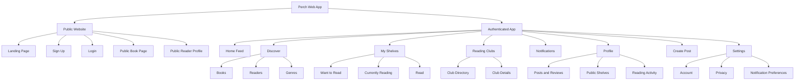

# Perch — Web Information Architecture

**Platform:** Desktop-first responsive web application.

## 1. Primary Navigation

Perch uses a persistent left sidebar on desktop. Primary destinations remain accessible throughout the authenticated experience.

### Navigation structure

- **Home** — Reader feed and activity.
- **Discover** — Explore books, readers and genres.
- **My Shelves** — Want to Read, Currently Reading and Read.
- **Reading Clubs** — Discover and participate in book communities.
- **Notifications** — Replies, reactions, follows and club activity.
- **Profile** — Reader identity, reviews and public shelves.
- **Create** — Publish a book reaction, review or recommendation.

### Desktop application shell

```text
┌──────────────────────────────────────────────────────────────────────┐
│ Perch                                      Search       Notifications │
├──────────────┬───────────────────────────────────┬───────────────────┤
│              │                                   │                   │
│  Home        │                                   │ Suggested readers │
│  Discover    │          Main content             │                   │
│  My Shelves  │                                   │ Trending genres   │
│  Clubs       │          Feed / Page              │                   │
│              │                                   │                   │
│  + Create    │                                   │                   │
│              │                                   │                   │
│  Profile     │                                   │                   │
│  Settings    │                                   │                   │
│              │                                   │                   │
└──────────────┴───────────────────────────────────┴───────────────────┘
```

The right sidebar is contextual and optional. It may contain suggested readers, genres or reading-club activity.

## 2. Sitemap



## 3. Page Inventory

| Page | Purpose | Priority |
|---|---|---|
| Landing Page | Explain Perch and introduce reader-led discovery | MVP |
| Sign Up / Login | Account creation and authentication | MVP |
| Home Feed | Discover books through reader posts | MVP |
| Discover | Search and browse books, readers and genres | MVP |
| Book Detail | Book information, reader reviews and expectation match | MVP |
| Reader Profile | Reader identity, shelves, reviews and activity | MVP |
| My Shelves | Organise reading activity | MVP |
| Create Post | Publish a reaction, review or recommendation | MVP |
| Post Detail | View a post and its discussion | MVP |
| Notifications | Keep up with relevant activity | MVP |
| Reading Clubs | Discover and participate in communities | Validate MVP scope |
| Settings | Account, privacy and notification preferences | MVP |
| Writer Workspace | Publish writing and receive feedback | Later phase |
| Institution Portal | Manage writing programmes and evaluations | Later phase |
| Publisher Portal | Manage verified catalogues and promotions | Later phase |

## 4. Key Page Structures

### Home Feed
- Global header with logo, search, notifications and account menu.
- Persistent left navigation.
- Central feed containing book posts and reader opinions.
- Optional right sidebar with suggested readers, genres and clubs.
- Feed cards should clearly identify the reader, book and type of post.

### Discover
- Search books and readers.
- Browse by genre.
- Explore curated book collections.
- Display book and reader cards.
- Add advanced filters only when validated through research.

### Book Detail
- Book cover, title, author and publication information.
- Add-to-shelf action.
- Reader reviews and reactions.
- Separate enjoyment and expectation-match ratings.
- Reviews from readers with similar tastes.
- Clearly labelled external purchase links.

### Reader Profile
- Display name, profile image and bio.
- Genre and reading preferences.
- Follow action.
- Reviews and posts.
- Public reading shelves.
- Recent reading activity.

### Create Post
- Search and attach a book.
- Write a reaction, review or recommendation.
- Add enjoyment and expectation-match ratings where applicable.
- Mark spoilers.
- Preview the post.
- Publish.

A dedicated compose page is preferable for longer reviews. A modal may be considered for short reactions.

## 5. Responsive Behaviour

| Viewport | Navigation | Layout |
|---|---|---|
| Desktop | Persistent left sidebar | Main feed with optional right sidebar |
| Small desktop | Collapsible sidebar | Main content; contextual sidebar may disappear |
| Tablet | Compact or top navigation | Single-column content |
| Mobile browser | Compact menu | Single-column responsive layout |

Desktop is the primary design target. Mobile browser support should preserve essential functionality without introducing separate mobile-only product flows.

## 6. Navigation and Interaction Rules

- Search should be accessible throughout the authenticated application.
- Create should be a prominent action.
- Book, reader and post pages should have shareable URLs.
- Browser back and forward navigation should behave predictably.
- Active navigation state should be visible.
- Important actions must not depend on hover.
- Support keyboard navigation and visible focus states.
- Clearly distinguish external retailer links from Perch functionality.

## 7. Open Decisions

- Should Create open a dedicated page, a modal or both?
- Should Reading Clubs be included in the first release?
- Should the right sidebar contain personalised or editorial content?
- Which pages should be accessible without signing in?
- What should the default privacy settings be for reader profiles and shelves?
- Should the feed have multiple viewing modes?
